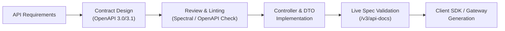

# API Specification Skill

Use this skill when designing, authoring, reviewing, or updating REST API specifications in any Spring Boot microservice. Follow this structured procedure to guarantee RFC compliance, contract stability, backward compatibility, and developer ergonomics across frontend, backend, QA, and API Gateway consumers.

---

## 1. Specification Lifecycle & Architecture

Enterprise API design follows a **Contract-First** or **Code-First with Continuous Verification** approach:



### Core Tenets:
1. **Single Source of Truth:** The API contract defines expectations before or alongside implementation. Never expose internal database entities or domain models directly.
2. **Schema Separation:** Every endpoint specifies distinct request and response schemas (DTOs).
3. **Idempotency Standards:** All mutating requests (`POST`, `PUT`, `PATCH`) must specify the `Idempotency-Key` header and document `409 Conflict` behavior.
4. **Error Uniformity:** Error responses must reference the standard `ApiErrorResponse` envelope across all status codes (400, 401, 403, 404, 409, 422, 500).

---

## 2. OpenAPI 3.0 Specification Authoring Rules

### 2.1 File Location & Naming
- Project Specification: `docs/openapi.yaml` (or `specs/openapi.yaml`).
- Format: Prefer **YAML** for readability, clean version control diffs, and developer ergonomics.

### 2.2 Root Object Structure
```yaml
openapi: 3.0.3
info:
  title: "<Service Name> API"
  description: "<Executive description of capabilities, protocols, and security>"
  version: "1.0.0"
  contact:
    name: "Engineering Team"
    email: "support@example.com"
  license:
    name: "Apache 2.0"
    url: "https://www.apache.org/licenses/LICENSE-2.0"
servers:
  - url: "/"
    description: "Current environment root"
  - url: "http://localhost:8080"
    description: "Local development"
```

### 2.3 Operation Requirements
Every path item must define:
- `operationId`: Unique camelCase identifier (e.g. `createFileMetadata`, `downloadFile`).
- `summary`: Concise 3-7 word verb phrase describing the goal.
- `description`: Detailed operational behavior, concurrency implications, idempotency handling, and storage mechanisms.
- `tags`: Grouped by business domain resource (e.g. `File Management`, `Multipart Uploads`).
- `parameters`: Explicit `in: path`, `in: query`, or `in: header` declarations with descriptions, types, and constraints.
- `requestBody`: Explicit `required: true/false`, with `content.<media-type>.schema`.
- `responses`: At least `200/201/204`, plus all applicable client error codes (`400`, `404`, `409`, `500`).

---

## 3. Standard Headers & Reusable Components

Define all reusable elements under `components:` to avoid duplication:

### 3.1 Common Security & Idempotency Headers
```yaml
components:
  securitySchemes:
    BearerAuth:
      type: http
      scheme: bearer
      bearerFormat: JWT
      description: "JWT Bearer token issued by OAuth2 / Keycloak"
    IdempotencyKey:
      type: apiKey
      in: header
      name: Idempotency-Key
      description: "UUID v4 token for HTTP mutation deduplication and replay protection"

  headers:
    IdempotencyReplay:
      description: "Indicates that the response was served from the idempotency cache"
      schema:
        type: boolean
        example: true
    ContentDisposition:
      description: "RFC 5987 / RFC 6266 filename attachment header"
      schema:
        type: string
        example: 'attachment; filename="report.pdf"; filename*=UTF-8''report.pdf'
```

### 3.2 Error Schema (`ApiErrorResponse`)
```yaml
components:
  schemas:
    ApiErrorResponse:
      type: object
      required:
        - errorCode
        - errorMessage
        - timestamp
      properties:
        errorCode:
          type: string
          example: "FILE_NOT_FOUND"
          description: "Machine-readable business or validation error code"
        errorMessage:
          type: string
          example: "File with the requested ID was not found"
          description: "Human-readable diagnostic message"
        errorDetails:
          type: object
          additionalProperties:
            type: string
          example:
            name: "must not be blank"
          description: "Map of field-specific validation errors"
        timestamp:
          type: string
          format: date-time
          example: "2026-11-19T10:00:00Z"
        path:
          type: string
          example: "/api/v1/files/c71a3374-1234-4567-89ab-cdef01234567"
```

### 3.3 Pagination Schema (`PagingRequest` & `PagingResponse`)
```yaml
components:
  schemas:
    PagingRequest:
      type: object
      required:
        - page
        - pageSize
      properties:
        page:
          type: integer
          minimum: 1
          default: 1
          description: "1-based page index"
        pageSize:
          type: integer
          minimum: 1
          maximum: 100
          default: 20
          description: "Items per page"
        filters:
          type: array
          items:
            $ref: '#/components/schemas/FilterCriteria'
        orders:
          type: array
          items:
            $ref: '#/components/schemas/OrderCriteria'

    PagingResponse:
      type: object
      required:
        - items
        - page
        - pageSize
        - totalItems
        - totalPages
        - hasPrevious
        - hasNext
      properties:
        items:
          type: array
          items:
            type: object
        page:
          type: integer
        pageSize:
          type: integer
        totalItems:
          type: integer
          format: int64
        totalPages:
          type: integer
        hasPrevious:
          type: boolean
        hasNext:
          type: boolean
```

---

## 4. SpringDoc OpenAPI Code Annotations Checklist

When implementing Spring Boot `@RestController` classes, align code with the specification:

1. **Class-Level Annotations:**
   ```java
   @RestController
   @RequestMapping("/api/v1/files")
   @Tag(name = "File Management", description = "Endpoints for file metadata lifecycle and streaming")
   ```
2. **Method-Level Annotations:**
   ```java
   @Operation(
       summary = "Create file metadata",
       description = "Initializes metadata in PENDING_UPLOAD status under idempotency control."
   )
   @ApiResponses({
       @ApiResponse(responseCode = "200", description = "Metadata created",
           content = @Content(schema = @Schema(implementation = FileMetadataCreateResponse.class))),
       @ApiResponse(responseCode = "400", description = "Validation error",
           content = @Content(schema = @Schema(implementation = ApiErrorResponse.class))),
       @ApiResponse(responseCode = "409", description = "Concurrency collision",
           content = @Content(schema = @Schema(implementation = ApiErrorResponse.class)))
   })
   ```
3. **Parameter Annotations:**
   ```java
   @Parameter(description = "UUID of the file", required = true, example = "c71a3374-1234-4567-89ab-cdef01234567")
   @PathVariable UUID id
   ```
4. **DTO Schema Descriptions:**
   ```java
   @Schema(description = "Display name of the file", example = "annual-report-2026", requiredMode = Schema.RequiredMode.REQUIRED)
   @NotBlank
   private String name;
   ```

---

## 5. Backward Compatibility & Breaking Change Guardrails

Never introduce breaking changes to published API specifications:

| Change Type | Breaking / Non-Breaking | Policy |
| :--- | :--- | :--- |
| **Add optional field to request** | Non-Breaking | Allowed |
| **Add new field to response** | Non-Breaking | Allowed (clients must ignore unknown fields) |
| **Add new endpoint** | Non-Breaking | Allowed |
| **Add new required field to request** | **BREAKING** | **Forbidden** in current version. Bump URL major version (`/api/v2/...`). |
| **Remove/rename existing field** | **BREAKING** | **Forbidden**. Deprecate first, remove only in next major version. |
| **Change field data type or format**| **BREAKING** | **Forbidden**. |
| **Change HTTP status code** | **BREAKING** | **Forbidden**. |
| **Tighten validation constraints** | **BREAKING** | **Forbidden** if it rejects payloads previously valid. |

---

## 6. Verification Checklist

Before publishing or finalizing an API specification:
- [ ] Conforms to OpenAPI 3.0.3+ syntax.
- [ ] Every path has unique `operationId` and explicit `summary`.
- [ ] `Idempotency-Key` documented for all mutating actions (`POST`, `PUT`, `PATCH`).
- [ ] Error responses reference unified `ApiErrorResponse` schema.
- [ ] Streaming binary endpoints declare `format: binary` with appropriate MIME types.
- [ ] Backward compatibility audit passed (no breaking schema mutations).
- [ ] Spotless formatting and unit tests verified via `./gradlew check` / `./mvnw verify`.
