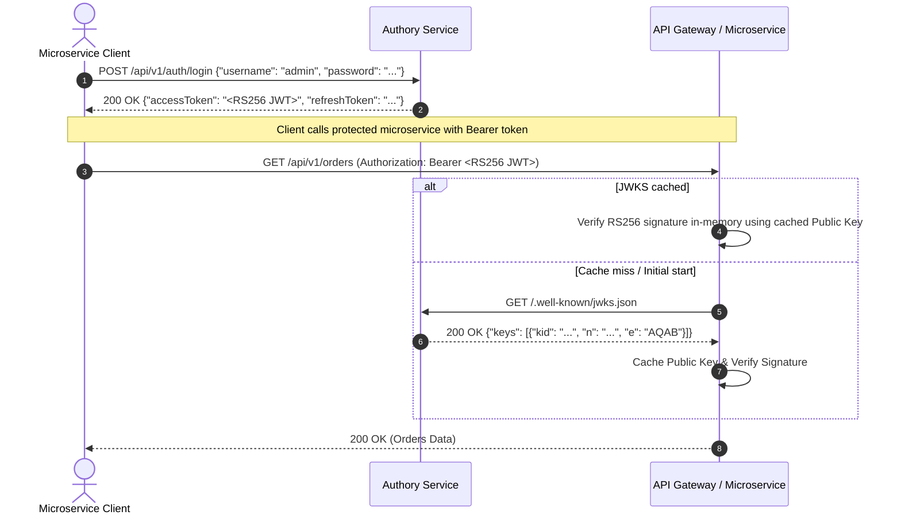

# Authory Service API Guidelines & Integration Manual

**Enterprise Identity, Authentication & Fine-Grained Authorization Microservice**  
Conforms to RFC 9110 (HTTP Semantics), RFC 7517 (JWKS), RFC 6238 (TOTP MFA), and RFC 6750 (OAuth 2.0 Bearer Token). Standardized on `be-platform` shared kernel abstractions.

---

## 1. Overview & Protocol Standards

- **Base URL:** `http://localhost:8600`
- **Interactive Documentation:** Swagger UI at `http://localhost:8600/swagger-ui.html`
- **OpenAPI 3.0 Schema (JSON):** `http://localhost:8600/v3/api-docs`
- **OpenAPI 3.0 Schema (YAML):** [docs/openapi.yaml](./openapi.yaml) or `http://localhost:8600/v3/api-docs.yaml`
- **JWKS Discovery Endpoints:** `/api/v1/auth/jwks.json` and `/.well-known/jwks.json`
- **Payload Encoding:** UTF-8 JSON (`application/json`)
- **Authentication Scheme:** Bearer Token via HTTP `Authorization` header (`Authorization: Bearer <accessToken>`)
- **Partner B2B Authentication:** `Client-Id` and `Client-Key` headers
- **Distributed Tracing Header:** `X-Correlation-Id` (UUID propagated across request/response and SLF4J MDC)
- **Rate Limiting:** Distributed sliding-window rate limiting via Redis (`platform.ratelimit` / `ratelimit-redis` / Redisson) on sensitive authentication endpoints (`/api/v1/auth/login`, `/api/v1/auth/register`, `/api/v1/auth/mfa/verify`, `/api/v1/auth/forgot-password`, `/api/v1/auth/reset-password`). Returns `HTTP 429 Too Many Requests` with RFC-standard rate limit response headers (`X-RateLimit-Limit`, `X-RateLimit-Remaining`, `Retry-After`).

---

## 2. JWT Token Standards & Claims Structure

Authory Service generates stateless RS256 (asymmetric) or HS256 tokens fully compatible with OpenID Connect (OIDC), `be-platform:security-jwt`, Spring Security `OAuth2ResourceServer`, and standard API Gateways (Kong, Envoy).

### 2.1 Access Token Claims Payload

```json
{
  "iss": "authory-service",
  "sub": "550e8400-e29b-41d4-a716-446655440000",
  "uid": "550e8400-e29b-41d4-a716-446655440000",
  "preferred_username": "john.doe",
  "username": "john.doe",
  "type": "USER",
  "roles": [
    "ROLE_ADMIN",
    "ROLE_USER"
  ],
  "permissions": [
    "USER:READ",
    "USER:WRITE",
    "REPORT:EXPORT"
  ],
  "groups": [
    "IT_DEPARTMENT",
    "SECURITY_AUDITORS"
  ],
  "iat": 1732658400,
  "exp": 1732662000
}
```

#### Standard Claims Mapping:
| Claim | Standard | Purpose / Compatibility |
| :--- | :--- | :--- |
| `sub` | RFC 7519 / OIDC | User UUID subject identifier (primary identifier in standard OIDC and `be-platform`) |
| `preferred_username` | OIDC Core 5.1 | Human-readable account username (standard OIDC claim) |
| `uid` | Backward Compatibility | User UUID for legacy clients |
| `username` | Backward Compatibility | Username for legacy clients |
| `roles` | Enterprise RBAC | Assigned role codes |
| `permissions` | Enterprise RBAC | Flat list of granted permission strings |
| `groups` | Enterprise RBAC | Group membership codes |
| `type` | Enterprise Multi-Tenant | Caller principal classification: `USER` or `PARTNER` |

---

## 3. Global Request & Response Envelopes

### 3.1 Standard Pagination Request (`PagingRequest`)
Pagination and dynamic field filtering are sent via HTTP `POST` to `/get-page` endpoints:

```json
{
  "page": 0,
  "pageSize": 20,
  "quickFilter": "john",
  "orders": [
    {
      "field": "createdAt",
      "sort": "desc"
    }
  ],
  "filters": [
    {
      "field": "status",
      "operator": "EQUALS",
      "value": "ACTIVE"
    }
  ]
}
```

#### Simple URL Query Alternative (HTTP GET):
All query endpoints also support standard query parameters:
```bash
GET /api/v1/users?page=0&pageSize=20&sortBy=createdAt&sortDir=desc&search=john
```

### 3.2 Standard Pagination Response (`PagingResponse<T>`)
All paginated queries return the uniform structure:

```json
{
  "data": [ ... ],
  "meta": {
    "page": 0,
    "pageSize": 20,
    "totalElements": 150,
    "totalPages": 8
  }
}
```

### 3.3 Standard Error Response Envelope (`ApiErrorResponse`)
When an error occurs, the server returns an `ApiErrorResponse` standardized from `be-platform:shared-kernel`:

```json
{
  "status": 404,
  "errorCode": "USER_NOT_FOUND",
  "errorMessage": "User not found with identifier: 550e8400-e29b-41d4-a716-446655440000",
  "errorDetails": null,
  "timestamp": "2026-11-26 20:50:00",
  "path": "/api/v1/users/550e8400-e29b-41d4-a716-446655440000",
  "traceId": "e4f9812b-3b8f-49b8-a612-9c1628d052d1"
}
```

#### Fields Description (`com.linhtn.sharedkernel.representation.ApiErrorResponse`):
| Field | Type | Description |
| :--- | :--- | :--- |
| `status` | `Integer` | HTTP status code integer (e.g. `400`, `401`, `404`, `409`, `500`) |
| `errorCode` | `String` | Machine-readable domain error code (e.g. `USER_NOT_FOUND`, `CONCURRENT_UPDATE_CONFLICT`, `METHOD_ARGUMENT_NOT_VALID`) |
| `errorMessage` | `String` | Localized, human-readable error description resolved via `MessageResolver` |
| `errorDetails` | `Object` | Optional structured validation error details (e.g. map of `{ field: "error message" }`) or `null` |
| `timestamp` | `LocalDateTime` | Timestamp formatted as `yyyy-MM-dd HH:mm:ss` |
| `path` | `String` | Request URI path where the error occurred |
| `traceId` | `String` | Distributed tracing / Correlation ID for observability tracking across Jaeger and logs |

#### Validation Error Example:
```json
{
  "status": 400,
  "errorCode": "METHOD_ARGUMENT_NOT_VALID",
  "errorMessage": "Validation failed for one or more fields",
  "errorDetails": {
    "username": "Username must be between 3 and 50 characters",
    "email": "Email must be a valid email address"
  },
  "timestamp": "2026-11-26 20:50:00",
  "path": "/api/v1/users",
  "traceId": "11111111-2222-3333-4444-555555555555"
}
```

### 3.4 Concurrency Conflicts & Optimistic Locking (`HTTP 409 Conflict`)
The service enforces **JPA Optimistic Locking** (`@Version`) and unique constraints across all mutable entities to prevent race conditions and lost updates.

When two concurrent requests attempt to mutate the same resource simultaneously:

```http
HTTP/1.1 409 Conflict
Content-Type: application/json
X-Correlation-Id: e4f9812b-3b8f-49b8-a612-9c1628d052d1

{
  "status": 409,
  "errorCode": "CONCURRENT_UPDATE_CONFLICT",
  "errorMessage": "The resource was updated concurrently by another request. Please reload latest state.",
  "errorDetails": null,
  "timestamp": "2026-11-26 20:51:00",
  "path": "/api/v1/users/550e8400-e29b-41d4-a716-446655440000",
  "traceId": "e4f9812b-3b8f-49b8-a612-9c1628d052d1"
}
```

**Client Best Practice:** When receiving `409 Conflict`, reload the fresh resource state (with the new `version` integer) and re-apply changes.

---

## 4. Endpoints Catalog

### 4.1 Authentication & Sessions (`/api/v1/auth`)

| Method | Endpoint | Request Body | Response Body | Description | Public / Auth |
| :--- | :--- | :--- | :--- | :--- | :--- |
| `POST` | `/api/v1/auth/register` | `RegisterRequest` | `Void` (201) | Register new user profile (Rate limited) | Public |
| `POST` | `/api/v1/auth/login` | `AuthLoginRequest` | `AuthLoginResponse` | Authenticate with credentials. Issues RS256 JWTs or temp token if MFA active | Public |
| `POST` | `/api/v1/auth/mfa/verify` | `MfaVerifyRequest` | `AuthLoginResponse` | Verify RFC 6238 6-digit TOTP code and issue tokens | Public |
| `POST` | `/api/v1/auth/mfa/setup` | - | `MfaSetupResponse` | Generate new TOTP secret & QR code URI | Authenticated |
| `POST` | `/api/v1/auth/mfa/enable` | `MfaEnableRequest` | `Void` | Confirm first TOTP code and enable 2FA | Authenticated |
| `POST` | `/api/v1/auth/mfa/disable` | `MfaDisableRequest` | `Void` | Disable 2FA with password & TOTP confirmation | Authenticated |
| `POST` | `/api/v1/auth/forgot-password` | `ForgotPasswordRequest` | `Void` | Request password reset token | Public |
| `POST` | `/api/v1/auth/reset-password` | `ResetPasswordRequest` | `Void` | Reset password using reset token | Public |
| `GET` | `/api/v1/auth/logout` | - | `Void` | Blacklist current JWT access token via Redis TTL and revoke refresh session | Authenticated |
| `GET` | `/api/v1/auth/refresh-token` | Header `refreshToken` | `AuthLoginResponse` | Rotate refresh token and issue new access token | Public |
| `GET` | `/api/v1/auth/principal` | - | `Principal` | Resolve caller identity and aggregated authority claims | Authenticated |
| `GET` | `/api/v1/auth/principal/user` | Query `userId` | `Principal` | Internal query to resolve user authorities by UUID | Authenticated |
| `GET` | `/api/v1/auth/principal/partner` | Headers (`Client-Id`, `Client-Key`) | `Principal` | Authenticate B2B partner via API keys (Cached in Redis) | Public |
| `GET` | `/api/v1/auth/jwks.json` | - | `JwksDocument` | RFC 7517 JSON Web Key Set for public key discovery | Public |
| `GET` | `/.well-known/jwks.json` | - | `JwksDocument` | Standard OIDC well-known JWKS discovery endpoint | Public |

### 4.2 Active Device Sessions (`/api/v1/auth/sessions`)

| Method | Endpoint | Request Body | Response Body | Description |
| :--- | :--- | :--- | :--- | :--- |
| `GET` | `/api/v1/auth/sessions` | - | `List<SessionGetResponse>` | List all active device sessions for current user |
| `DELETE` | `/api/v1/auth/sessions/{id}` | - | `Void` (204) | Remotely terminate and invalidate a specific device session |
| `POST` | `/api/v1/auth/sessions/revoke-all` | - | `Void` (204) | Revoke all active sessions across all other devices |

### 4.3 User Management (`/api/v1/users`)

| Method | Endpoint | Request Body | Response Body | Description |
| :--- | :--- | :--- | :--- | :--- |
| `GET` | `/api/v1/users` | Query params | `PagingResponse<UserGetResponse>` | Paginated user query via URL params |
| `POST` | `/api/v1/users/get-page` | `PagingRequest` | `PagingResponse<UserGetResponse>` | Advanced criteria pagination (multi-sort & filters) |
| `GET` | `/api/v1/users/{id}` | - | `UserGetResponse` | Retrieve user details by UUID |
| `POST` | `/api/v1/users` | `UserCreateRequest` | `UserCreateResponse` (201) | Create user and publish `UserCreatedEvent` |
| `PUT` | `/api/v1/users/{id}` | `UserUpdateRequest` | `UserUpdateResponse` | Update user profile and publish `UserUpdatedEvent` (Optimistic lock) |
| `DELETE` | `/api/v1/users/{id}` | - | `Void` (204) | Delete user account and publish `UserDeletedEvent` |
| `POST` | `/api/v1/users/{id}/unlock` | - | `Void` | Reset failed login counter and unfreeze locked account |

### 4.4 ABAC Policy Decision Point & Attributes

#### Dynamic Policy Decision Point (`/api/v1/abac`):
| Method | Endpoint | Request Body | Response Body | Description |
| :--- | :--- | :--- | :--- | :--- |
| `POST` | `/api/v1/abac/evaluate` | `PolicyEvaluationRequest` | `PolicyEvaluationResponse` | Evaluate dynamic SpEL policy against subject, resource, and environment |

#### Attribute Definitions (`/api/v1/attributes`):
| Method | Endpoint | Request Body | Response Body | Description |
| :--- | :--- | :--- | :--- | :--- |
| `GET` | `/api/v1/attributes` | Query params | `PagingResponse<AttributeGetResponse>` | Simple paginated list of attributes |
| `POST` | `/api/v1/attributes/get-page` | `PagingRequest` | `PagingResponse<AttributeGetResponse>` | Criteria pagination of attributes |
| `GET` | `/api/v1/attributes/{id}` | - | `AttributeGetResponse` | Get attribute by ID (Cached in Redis) |
| `POST` | `/api/v1/attributes` | `AttributeCreateRequest` | `AttributeCreateResponse` (201) | Create attribute schema definition |
| `PUT` | `/api/v1/attributes/{id}` | `AttributeUpdateRequest` | `AttributeUpdateResponse` | Update attribute definition (Evicts Redis cache) |
| `DELETE` | `/api/v1/attributes/{id}` | - | `Void` (204) | Delete attribute definition (Evicts Redis cache) |

#### User Attribute Bindings (`/api/v1/users/attributes`):
| Method | Endpoint | Request Body | Response Body | Description |
| :--- | :--- | :--- | :--- | :--- |
| `GET` | `/api/v1/users/attributes` | Query params | `PagingResponse<UserAttributeGetResponse>` | Simple paginated user attribute values |
| `POST` | `/api/v1/users/attributes/get-page` | `PagingRequest` | `PagingResponse<UserAttributeGetResponse>` | Criteria pagination of user attribute values |
| `GET` | `/api/v1/users/attributes/{id}` | - | `UserAttributeGetResponse` | Get user attribute binding by ID |
| `POST` | `/api/v1/users/attributes` | `UserAttributeCreateRequest` | `UserAttributeCreateResponse` (201) | Bind custom attribute value to user |
| `PUT` | `/api/v1/users/attributes/{id}` | `UserAttributeUpdateRequest` | `UserAttributeUpdateResponse` | Update bound attribute value |
| `DELETE` | `/api/v1/users/attributes/{id}` | - | `Void` (204) | Delete attribute binding |
| `POST` | `/api/v1/users/attributes/user/{userId}` | `UserAttributeCreateRequest` | `Void` (201) | Add attribute directly to user by `userId` |

### 4.5 RBAC Modules (Roles, Permissions, Groups, Resources)

Each RBAC entity supports standard CRUD (`GET`, `POST`, `POST /get-page`, `GET /{id}`, `PUT /{id}`, `DELETE /{id}`):
- `/api/v1/roles` (Security Roles)
- `/api/v1/permissions` (Action & Resource Permissions)
- `/api/v1/groups` (User Authority Groups)
- `/api/v1/resources` (Secured URI Pattern Resources)

#### Many-to-Many Relational Associations:
| Entity Association | Endpoints | Description |
| :--- | :--- | :--- |
| **Role Permissions** | `GET /api/v1/roles/{roleId}/permissions`<br/>`PUT /api/v1/roles/{roleId}/permissions`<br/>`POST /api/v1/roles/{roleId}/permissions/{permissionId}`<br/>`DELETE /api/v1/roles/{roleId}/permissions/{permissionId}` | Manage permissions assigned to roles. Automatically evicts cached user authorities in Redis. |
| **Group Permissions** | `GET /api/v1/groups/{groupId}/permissions`<br/>`PUT /api/v1/groups/{groupId}/permissions`<br/>`POST /api/v1/groups/{groupId}/permissions/{permissionId}`<br/>`DELETE /api/v1/groups/{groupId}/permissions/{permissionId}` | Manage permissions assigned to user groups. |
| **Resource Permissions** | `GET /api/v1/resources/{resourceId}/permissions`<br/>`PUT /api/v1/resources/{resourceId}/permissions`<br/>`POST /api/v1/resources/{resourceId}/permissions/{permissionId}`<br/>`DELETE /api/v1/resources/{resourceId}/permissions/{permissionId}` | Assign permission scopes required to access a protected resource. |
| **User Roles** | `GET /api/v1/users/{userId}/roles`<br/>`PUT /api/v1/users/{userId}/roles`<br/>`POST /api/v1/users/{userId}/roles/{roleId}`<br/>`DELETE /api/v1/users/{userId}/roles/{roleId}` | Assign security roles to user identity. Automatically invalidates Redis cache. |
| **User Groups** | `GET /api/v1/users/{userId}/groups`<br/>`PUT /api/v1/users/{userId}/groups`<br/>`POST /api/v1/users/{userId}/groups/{groupId}`<br/>`DELETE /api/v1/users/{userId}/groups/{groupId}` | Manage user group memberships. |
| **User Resources** | `GET /api/v1/users/{userId}/resources`<br/>`PUT /api/v1/users/{userId}/resources`<br/>`POST /api/v1/users/{userId}/resources/{resourceId}`<br/>`DELETE /api/v1/users/{userId}/resources/{resourceId}` | Direct resource authorizations on specific users. |

### 4.6 Partner Management (`/api/v1/partners`)
Multi-tenant B2B partner registration, credential rotation, and tenant isolation:
- `GET /api/v1/partners`
- `POST /api/v1/partners/get-page`
- `GET /api/v1/partners/{id}`
- `POST /api/v1/partners` (Generates unique `Client-Id` and hashed `Client-Key`)
- `PUT /api/v1/partners/{id}`
- `DELETE /api/v1/partners/{id}`

### 4.7 Enterprise Organization Hierarchy
Hierarchical organizational node management supporting enterprise corporate structures:
- **Companies:** `/api/v1/companies` (Root holding entities)
- **Branches:** `/api/v1/branchs` (Regional branch offices)
- **Centers:** `/api/v1/centers` (Operational centers)
- **Divisions:** `/api/v1/divisions` (Corporate business divisions)
- **Departments:** `/api/v1/departments` (Department units)
- **Positions:** `/api/v1/positions` (Job titles and classifications)

### 4.8 Dashboard & Audit (`/api/v1/dashboard`)
- `GET /api/v1/dashboard/metrics`: Real-time aggregation of total users, active sessions, tenant count, and role statistics.
- `GET /api/v1/dashboard/recent-activities`: 20 most recent system audit log events generated by domain event listeners (`SystemActivityListener`).

---

## 5. End-to-End Workflow Examples

### 5.1 RS256 JWKS Token Verification Flow



### 5.2 Dynamic ABAC Policy Evaluation Example

```bash
curl -X POST http://localhost:8600/api/v1/abac/evaluate \
  -H "Content-Type: application/json" \
  -H "Authorization: Bearer <accessToken>" \
  -d '{
    "userId": "550e8400-e29b-41d4-a716-446655440000",
    "action": "READ",
    "resourceType": "FINANCIAL_REPORT",
    "resourceAttributes": {
      "department": "Finance",
      "minClearanceLevel": 3,
      "policyExpression": "#subject[\x27department\x27] == #resource[\x27department\x27]"
    },
    "environmentAttributes": {
      "ipAddress": "10.0.0.15",
      "requestTime": "14:30:00"
    }
  }'
```

#### Sample Response:
```json
{
  "allowed": true,
  "decision": "PERMIT",
  "reason": "Access granted based on attribute policy evaluation",
  "evaluatedSubjectAttributes": {
    "username": "alice",
    "department": "Finance",
    "clearanceLevel": 3
  },
  "matchedRules": [
    "policyExpression: #subject['department'] == #resource['department']",
    "department_match: Finance"
  ]
}
```

### 5.3 Active Device Session Revocation Flow

```bash
# 1. List active device sessions
curl -X GET http://localhost:8600/api/v1/auth/sessions \
  -H "Authorization: Bearer <accessToken>"

# 2. Terminate all other sessions remotely
curl -X POST http://localhost:8600/api/v1/auth/sessions/revoke-all \
  -H "Authorization: Bearer <accessToken>"
```
