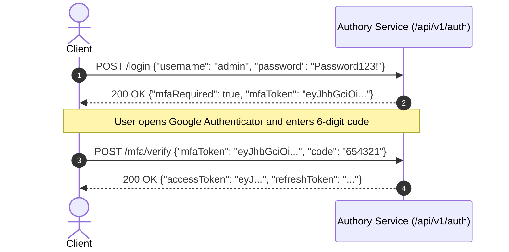

# Authory Service API Guidelines & Integration Manual

## 1. Overview & Protocol Standards

The **Authory Service** provides a centralized RESTful HTTP API conforming strictly to RFC 9110 (HTTP Semantics) and OpenAPI 3.0 standards.

- **Base URL:** `http://localhost:8600`
- **Interactive Documentation:** Swagger UI at `http://localhost:8600/swagger-ui.html`
- **OpenAPI 3.0 Schema:** `http://localhost:8600/v3/api-docs`
- **Payload Encoding:** UTF-8 JSON (`application/json`)
- **Authentication Scheme:** Bearer Token via HTTP `Authorization` header (`Authorization: Bearer <accessToken>`)
- **Distributed Tracing Header:** `X-Correlation-Id` (UUID propagated across request/response and SLF4J MDC)
- **Rate Limiting:** Sliding-window token bucket (60 requests/minute per client IP) on sensitive authentication endpoints (`/api/v1/auth/login`, `/api/v1/auth/register`, `/api/v1/auth/mfa/verify`, `/api/v1/auth/forgot-password`, `/api/v1/auth/reset-password`). Exceeding returns `HTTP 429 Too Many Requests` with a `Retry-After: 60` response header.

---

## 2. Global Request & Response Envelopes

### 2.1 Standard API Response Envelope (`ApiResponse<T>`)
Every single-item response is wrapped in an `ApiResponse<T>` envelope or returns the target entity directly:

```json
{
  "code": 200,
  "message": "Operation completed successfully",
  "data": { ... }
}
```

### 2.2 Standard Pagination Request (`PagingRequest`)
Pagination and dynamic field filtering are sent via HTTP `POST` to `/get-page` endpoints:

```json
{
  "page": 0,
  "pageSize": 10,
  "orders": [
    {
      "field": "createdAt",
      "sort": "desc"
    }
  ],
  "criteria": [
    {
      "field": "name",
      "operator": "like",
      "value": "Administrator"
    }
  ]
}
```

#### Supported Query Operators (`criteria.operator`):
| Operator | Description | Value Example |
| :--- | :--- | :--- |
| `equal` / `eq` | Exact match | `"ACTIVE"` |
| `like` | Partial string matching (case-insensitive) | `"John"` |
| `in` | Inclusion within a collection | `["ADMIN", "MANAGER"]` |
| `greaterThan` / `gt` | Strictly greater than | `"2026-01-01T00:00:00"` |
| `lessThan` / `lt` | Strictly less than | `"2026-12-31T23:59:59"` |

### 2.3 Standard Pagination Response Envelope (`PagingResponse<T>`)
All paginated queries return the uniform structure:

```json
{
  "items": [ ... ],
  "page": 0,
  "pageSize": 10,
  "totalItems": 42,
  "totalPages": 5,
  "hasPrevious": false,
  "hasNext": true
}
```

### 2.4 Error Response Envelope (`ApiErrorResponse`)
When an error occurs, the server returns an `ApiErrorResponse` containing standardized error metadata:

```json
{
  "timestamp": "2026-11-18T14:15:00.123Z",
  "status": 404,
  "error": "Not Found",
  "errorCode": "USER_NOT_FOUND",
  "message": "User not found with the requested identifier",
  "path": "/api/v1/users/550e8400-e29b-41d4-a716-446655440000"
}
```

### 2.5 Concurrency Conflicts & Race Conditions (HTTP 409 Conflict)
The service enforces **JPA Optimistic Locking** (`@Version`) and unique constraints across all mutable entities to prevent race conditions and lost updates.

When two concurrent requests attempt to mutate the same resource simultaneously:

```http
HTTP/1.1 409 Conflict
Content-Type: application/json
X-Correlation-Id: e4f9812b-3b8f-49b8-a612-9c1628d052d1

{
  "timestamp": "2026-11-18T15:52:00.000Z",
  "status": 409,
  "error": "Conflict",
  "errorCode": "CONCURRENT_UPDATE_CONFLICT",
  "message": "The resource was updated concurrently by another request. Please reload the latest data and try again.",
  "path": "/api/v1/users/550e8400-e29b-41d4-a716-446655440000"
}
```

**Client Best Practice:** When receiving `409 Conflict`, the client UI should reload the fresh resource state (with the updated `version` field) and re-apply user changes.

---

## 3. Endpoints Catalog

### 3.1 Authentication, MFA & Session Management (`/api/v1/auth`)

| Method | Endpoint | Request Body | Response Body | Description | Public / Auth |
| :--- | :--- | :--- | :--- | :--- | :--- |
| `POST` | `/api/v1/auth/login` | `LoginRequest` | `AuthResponse` | Authenticate user with credentials (Rate limited, Lockout enabled) | Public |
| `POST` | `/api/v1/auth/register` | `RegisterRequest` | `Void` | Register new user account (Rate limited) | Public |
| `POST` | `/api/v1/auth/refresh-token` | Header | `AuthResponse` | Exchange valid refresh token for a new access token | Public |
| `GET` | `/api/v1/auth/logout` | Header | `Void` | Revoke active refresh token | Authenticated |
| `POST` | `/api/v1/auth/mfa/setup` | - | `MfaSetupResponse` | Generate new TOTP secret & QR code URI | Authenticated |
| `POST` | `/api/v1/auth/mfa/enable` | `MfaEnableRequest` | `Void` | Verify initial 6-digit TOTP code and enable 2FA | Authenticated |
| `POST` | `/api/v1/auth/mfa/disable` | `MfaDisableRequest` | `Void` | Disable 2FA with password confirmation | Authenticated |
| `POST` | `/api/v1/auth/mfa/verify` | `MfaVerifyRequest` | `AuthResponse` | Complete 2-step login with temporary `mfaToken` + TOTP code | Public |
| `POST` | `/api/v1/auth/forgot-password` | `ForgotPasswordRequest` | `Void` | Request 15-minute password reset link/token | Public |
| `POST` | `/api/v1/auth/reset-password` | `ResetPasswordRequest` | `Void` | Reset password using valid reset token | Public |
| `GET` | `/api/v1/auth/sessions` | - | `List<SessionResponse>` | List all active device sessions for current user | Authenticated |
| `DELETE` | `/api/v1/auth/sessions/{id}` | - | `Void` | Revoke a specific active session | Authenticated |
| `POST` | `/api/v1/auth/sessions/revoke-all` | - | `Void` | Terminate all other active sessions | Authenticated |
| `GET` | `/api/v1/auth/principal/user` | Query `userId` | `Principal` | Resolve user principal context | Authenticated |
| `GET` | `/api/v1/auth/principal/partner` | Headers | `Principal` | Resolve partner principal context | Authenticated |

### 3.2 User Management (`/api/v1/users`)

| Method | Endpoint | Request Body | Response Body | Description |
| :--- | :--- | :--- | :--- | :--- |
| `POST` | `/api/v1/users` | `UserCreateRequest` | `UserResponse` | Create a new user |
| `POST` | `/api/v1/users/get-page` | `PagingRequest` | `PagingResponse<UserResponse>` | Paginated search with dynamic criteria |
| `GET` | `/api/v1/users/{id}` | - | `UserResponse` | Retrieve user profile by UUID |
| `PUT` | `/api/v1/users/{id}` | `UserUpdateRequest` | `UserResponse` | Update user profile |
| `DELETE` | `/api/v1/users/{id}` | - | `Void` | Soft delete user |
| `POST` | `/api/v1/users/{id}/unlock` | - | `Void` | Unlock an account locked by brute-force defense |

### 3.3 Dynamic ABAC Policy Decision Point (`/api/v1/abac`)

| Method | Endpoint | Request Body | Response Body | Description |
| :--- | :--- | :--- | :--- | :--- |
| `POST` | `/api/v1/abac/evaluate` | `PolicyEvaluationRequest` | `PolicyEvaluationResponse` | Evaluate dynamic contextual ABAC policy (PDP) |
| `POST` | `/api/v1/abac/attributes` | `AttributeCreateRequest` | `AttributeResponse` | Create attribute definition |
| `POST` | `/api/v1/abac/attributes/get-page` | `PagingRequest` | `PagingResponse<AttributeResponse>` | Paginated query of attributes |
| `POST` | `/api/v1/abac/user-attributes` | `UserAttributeCreateRequest` | `UserAttributeResponse` | Bind attribute value to user |
| `POST` | `/api/v1/abac/user-attributes/get-page` | `PagingRequest` | `PagingResponse<UserAttributeResponse>` | Paginated query of user attributes |

---

## 4. End-to-End Workflow Examples

### 4.1 Login with Multi-Factor Authentication (MFA) Flow



### 4.2 Dynamic ABAC Policy Evaluation Example

```bash
curl -X POST http://localhost:8600/api/v1/abac/evaluate \
  -H "Content-Type: application/json" \
  -H "Authorization: Bearer <accessToken>" \
  -d '{
    "userId": "550e8400-e29b-41d4-a716-446655440000",
    "action": "READ",
    "resourceType": "FINANCIAL_REPORT",
    "resourceAttributes": {
      "department": "Finance",
      "min_clearance_level": "3",
      "policy_expression": "#subject[\x27department\x27] == #resource[\x27department\x27]"
    },
    "environmentAttributes": {
      "request_ip": "10.0.0.15"
    }
  }'
```

#### Sample Response:
```json
{
  "allowed": true,
  "decision": "PERMIT",
  "reason": "Access granted based on attribute policy evaluation",
  "evaluatedSubjectAttributes": {
    "username": "alice",
    "department": "Finance",
    "clearance_level": "3"
  },
  "matchedRules": [
    "policy_expression: #subject['department'] == #resource['department']",
    "department_match: Finance",
    "clearance_level_satisfied: 3 >= 3"
  ]
}
```

### 4.3 View and Terminate Active Device Sessions

```bash
# List active sessions
curl -X GET http://localhost:8600/api/v1/auth/sessions \
  -H "Authorization: Bearer <accessToken>"

# Terminate all other sessions
curl -X POST http://localhost:8600/api/v1/auth/sessions/revoke-all \
  -H "Authorization: Bearer <accessToken>"
```

---

## 5. Interactive Swagger UI & OpenAPI 3.0 Specification

The service exposes interactive Swagger UI documentation and machine-readable OpenAPI 3.0 schemas automatically generated by `springdoc-openapi`:

- **Swagger UI Interactive Console:** [http://localhost:8600/swagger-ui.html](http://localhost:8600/swagger-ui.html)
- **OpenAPI 3.0 JSON Specification:** [http://localhost:8600/v3/api-docs](http://localhost:8600/v3/api-docs)
- **OpenAPI 3.0 YAML Specification:** [http://localhost:8600/v3/api-docs.yaml](http://localhost:8600/v3/api-docs.yaml)

### 5.1 Configured OpenAPI Security Schemes
1. **`BearerAuth` (HTTP Bearer JWT):**
   - Applied globally across all protected endpoints.
   - Header: `Authorization: Bearer <token>`
   - Authenticates users and populates `SecurityContextHolder` with claims and authorities.
2. **`ClientIdHeader` & `ClientKeyHeader` (API Keys in Header):**
   - Configured for multi-tenant B2B partner APIs.
   - Headers: `Client-Id: <clientId>`, `Client-Key: <clientKey>`

### 5.2 Documented Resource Tags
| Tag Name | Target Endpoints | Description |
| :--- | :--- | :--- |
| `Authentication & Sessions` | `/api/v1/auth/**` | Registration, login, MFA/2FA (TOTP), password reset, refresh token, and logout |
| `Active Device Sessions` | `/api/v1/auth/sessions/**` | Device tracking, IP metadata, and remote session termination |
| `User Management` | `/api/v1/users/**` | User CRUD, dynamic search, sorting, and administrative account unlock |
| `ABAC - Policy Evaluation` | `/api/v1/abac/evaluate` | Dynamic SpEL policy evaluation (PDP) against subject and resource attributes |
| `ABAC - Attributes` | `/api/v1/attributes/**` | Attribute catalog management |
| `ABAC - User Attributes` | `/api/v1/users/attributes/**` | User attribute binding management |
| `RBAC - Roles` | `/api/v1/roles/**` | Security roles catalog |
| `RBAC - Permissions` | `/api/v1/permissions/**` | Granular permission catalog |
| `RBAC - Resources` | `/api/v1/resources/**` | System resources catalog |
| `RBAC - Groups` | `/api/v1/groups/**` | User groups catalog |
| `RBAC - Role Permissions` | `/api/v1/roles/{roleId}/permissions/**` | Permission assignment to roles |
| `RBAC - Group Permissions` | `/api/v1/groups/{groupId}/permissions/**` | Permission assignment to groups |
| `RBAC - Resource Permissions` | `/api/v1/resources/{resourceId}/permissions/**` | Permission assignment to resources |
| `RBAC - User Roles` | `/api/v1/users/{userId}/roles/**` | Role assignment to users |
| `RBAC - User Groups` | `/api/v1/users/{userId}/groups/**` | Group membership assignment to users |
| `RBAC - User Resources` | `/api/v1/users/{userId}/resources/**` | Direct resource assignment to users |
| `Partner Management` | `/api/v1/partners/**` | B2B multi-tenant partner registration and isolation |
| `Organization - Companies` | `/api/v1/companies/**` | Company organizational nodes |
| `Organization - Divisions` | `/api/v1/divisions/**` | Division organizational nodes |
| `Organization - Branches` | `/api/v1/branchs/**` | Branch organizational nodes |
| `Organization - Centers` | `/api/v1/centers/**` | Center organizational nodes |
| `Organization - Departments` | `/api/v1/departments/**` | Department organizational nodes |
| `Organization - Positions` | `/api/v1/positions/**` | Staff position catalog |
| `Dashboard Overview` | `/api/v1/dashboard/**` | Aggregated system metrics and recent audit activity logs |
