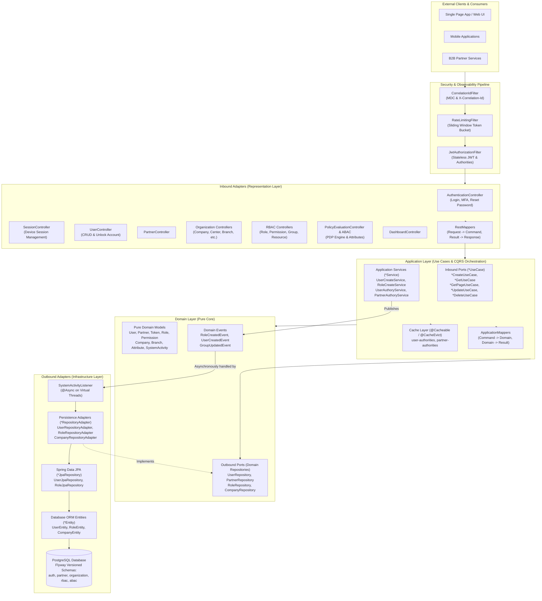

# System Architecture & Technical Design

## 1. Architectural Overview

The **Authory Service** is an enterprise-grade identity, authentication, authorization, and organizational structure authority service built on **Java 25** and **Spring Boot 4.0.0**.

The system is implemented as a **Modular Monolith** adhering strictly to **Hexagonal Architecture (Ports and Adapters)** and **Domain-Driven Design (DDD)** principles, matching enterprise clean architecture benchmarks.

### Core Architectural Tenets
1. **Decoupled Pure Domain Core:** Business rules, domain models, and aggregates are 100% free of Spring, JPA, Hibernate, and database annotations.
2. **Ports and Adapters Pattern:**
   - **Inbound Ports (Driver):** Use cases defining application entry points (`application/port/in`).
   - **Inbound Adapters:** REST Controllers and event listeners translating HTTP/external events into domain commands (`representation/rest/controller`).
   - **Outbound Ports (Driven):** Repository and service interfaces required by the application (`domain/repository`).
   - **Outbound Adapters:** Persistence adapters wrapping Spring Data JPA, queries, and ORM entities (`infrastructure/persistence`).
3. **Strict CQRS Segregation:** Every operational intent is divided into single-purpose components (`*CreateUseCase`, `*GetUseCase`, `*GetPageUseCase`, `*UpdateUseCase`, `*DeleteUseCase`), driven by explicit `*Command` payloads and returning isolated `*Result` objects.
4. **Flyway Enterprise Database Migrations:** Fully versioned DDL migrations across 5 schemas (`auth`, `partner`, `organization`, `rbac`, `abac`) managing 26 tables, constraints, and indexes.
5. **High-Performance Caching & Eviction:** Authority evaluations (`user-authorities`, `partner-authorities`) are cached with `@Cacheable` and automatically evicted with `@CacheEvict` when roles, permissions, groups, or resources are modified.
6. **Multi-Factor Authentication (MFA / 2FA via TOTP):** Native RFC 6238 TOTP engine built into the core without external dependencies, supporting QR code enrollment and 2-step verification with short-lived `MFA_PENDING` tokens.
7. **Brute-Force Account Lockout:** Tracks failed login attempts per user credential. Exceeding 5 failed attempts locks the account for 15 minutes, with an administrative unlock API.
8. **Active Device Session Management:** Captures client IP, User-Agent, and device metadata on token creation, with endpoints to view and remotely revoke sessions.
9. **Dynamic ABAC Policy Decision Point (PDP):** Policy engine evaluating subject attributes, resource attributes, environment context, and dynamic Spring Expression Language (SpEL) policies.
10. **Race Condition & Optimistic Locking Defense:** Centralized `@Version` in `BaseEntity` and `version BIGINT NOT NULL DEFAULT 0` across all 27 database tables. `GlobalApiExceptionHandler` automatically intercepts `OptimisticLockException` and `ConcurrencyFailureException`, translating them into standardized `HTTP 409 Conflict` payloads to prevent lost updates under high concurrency. Unique database constraints prevent race condition duplication during concurrent registrations.

---

## 2. High-Level Modular Hexagon Diagram

---

## 3. Layer Responsibilities & Strict Boundaries

| Layer | Package Path | Allowed Dependencies | Prohibited Dependencies | Primary Role |
| :--- | :--- | :--- | :--- | :--- |
| **Domain** | `modules/<feature>/domain` | Pure Java, Lombok (`@Getter`, `@Setter`, `@Builder`) | **No Spring, No JPA/Hibernate, No HTTP/Web, No DB** | Encapsulates domain models, business logic invariants, and repository port interfaces. |
| **Application** | `modules/<feature>/application` | Domain layer, Spring `@Service`, `@Transactional`, `@Cacheable`, `@CacheEvict` | **No Spring MVC Controllers, No JPA Entities, No DB schemas** | Orchestrates use cases, transactional workflows, and transforms domain models into application results. |
| **Representation** | `modules/<feature>/representation` | Application ports/DTOs, Domain models, Spring WebMVC, Jakarta Validation | **No direct JPA Entities, No direct DB access, No infrastructure code** | Handles HTTP requests, input validation, serialization to JSON, and REST error mapping. |
| **Infrastructure** | `modules/<feature>/infrastructure` | Domain repository ports, Spring Data JPA, Hibernate, PostgreSQL driver | **No domain orchestration, No HTTP handling** | Implements domain repository ports, maps domain models to database entities, and executes persistence logic. |

### 3.1 Cross-Module Communication via Inbound Ports

To preserve modular isolation and enforce clean Domain-Driven Design (DDD) bounded contexts:

1. **Mandatory Communication via Inbound Ports:**
   - When Module A requires data or business actions from Module B, it **MUST inject and call an Inbound Port (`application/port/in/*UseCase`)** exposed by Module B.
   - Example: `PartnerAuthenticationService` (in `auth`) accesses partner information exclusively through `PartnerGetUseCase` (port in `partner`).
   - Example: `DashboardGetMetricsService` (in `dashboard`) aggregates counts via `UserGetUseCase.count()`, `RoleGetUseCase.count()`, `TokenUseCase.countActiveSessions()`, etc.
   - Example: `PolicyEvaluationService` (in `abac`) retrieves user context via `UserGetUseCase.findById()`.
   - Example: `UserUnlockService` (in `user`) unlocks credentials via `UserCredentialUseCase.unlockAccount()`.

2. **Strict Prohibition on Cross-Module Repository Imports:**
   - A module **MUST NEVER** import or call a `*Repository` or `*RepositoryAdapter` from another module (e.g. `auth` importing `PartnerRepository` or `UserRepository` is strictly prohibited).
   - Repositories are internal outbound ports private to their owning module.

3. **Decoupled Asynchronous Integration via Domain Events:**
   - For state transitions (e.g. user created, role updated, permission revoked), modules publish domain events (`domain/event/*Event`).
   - Consumer modules (e.g. `SystemActivityListener` in `activity`) listen asynchronously (`@Async`, `@EventListener`) without coupling to the publisher's transactional boundaries.

---

## 4. Database Schema Lifecycle & Migrations

The schema lifecycle is managed by Flyway across 5 distinct database schemas:

1. **`V1__init_enterprise_schemas.sql`**: Initial creation of 5 schemas (`auth`, `partner`, `organization`, `rbac`, `abac`), 25 tables, constraints, foreign keys, and indexes.
2. **`V2__seed_default_roles_and_admin.sql`**: Seeds default roles (`SUPER_ADMIN`, `ADMIN`, `USER`), default system resources, and initial permission bindings.
3. **`V3__enterprise_iam_features.sql`**:
   - `auth.user_credentials`: Added `failed_login_attempts`, `locked_until`, `mfa_enabled`, `mfa_secret`.
   - `auth.tokens`: Added `ip_address`, `user_agent`, `device_name`, `last_active_at`, with composite index `idx_tokens_user_revoked`.
   - `auth.password_reset_tokens`: New table managing timed password reset tokens.
4. **`V4__add_optimistic_locking_version.sql`**:
   - Adds `version BIGINT NOT NULL DEFAULT 0` column to all 27 tables across `auth`, `partner`, `organization`, `rbac`, and `abac` to support JPA Optimistic Locking.
