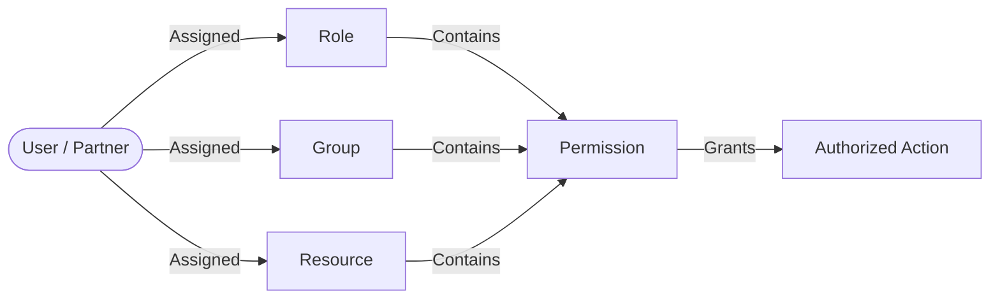
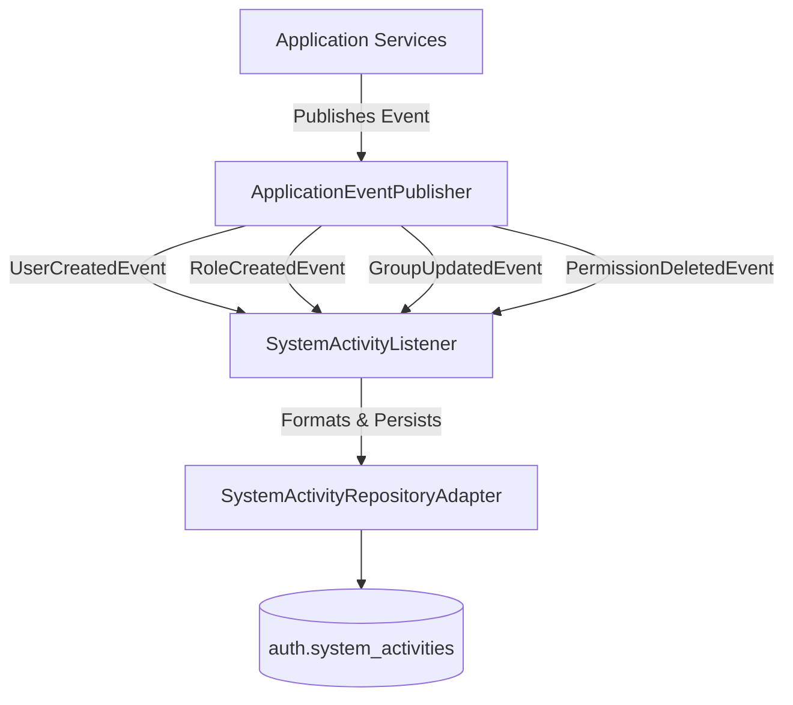

# Authory Service: Enterprise Architecture & Design

## 1. Executive Summary

The **Authory Service** is a centralized Identity and Access Management (IAM), Role-Based Access Control (RBAC), and Organizational Structure authority for the enterprise ecosystem.

Designed as a high-performance **Modular Monolith** using **Java 25** and **Spring Boot 4.0.0**, the service provides:
- Scalable multi-tenant and B2B partner authorization.
- Hybrid access control combining granular RBAC with dynamic ABAC.
- High-concurrency I/O leveraging Java 25 Virtual Threads.
- Hexagonal architecture ensuring total business logic decoupling from database and transport technologies.

---

## 2. Access Control Model: Hybrid RBAC + ABAC

Authory Service implements a hybrid authorization model combining the predictability of Role-Based Access Control (RBAC) with the flexibility of Attribute-Based Access Control (ABAC).

### 2.1 Role-Based Access Control (RBAC)
The RBAC engine allows organizational hierarchies and permissions to be structured into three tiers:
1. **Permissions:** Atomic capabilities consisting of a resource code, action, and type (e.g. `USER:READ:API`, `ORDER:APPROVE:BUTTON`).
2. **Roles & Groups:** Aggregations of permissions representing business functions (e.g. `SUPER_ADMIN`, `BRANCH_MANAGER`, `HR_SPECIALIST`).
3. **Resources:** Logical application partitions to which permissions are scoped.

### 2.2 Attribute-Based Access Control (ABAC)
For contextual access decisions (e.g., location restrictions, transaction thresholds, branch-level data boundaries), ABAC binds dynamic key-value attributes to user identities:
- **Attribute Definition:** Defines metadata key, data type (String, Number, Boolean, JSON), and validation rules.
- **User Attribute Binding:** Attaches values to individual users (e.g. `max_approval_amount = 50000`, `allowed_branch = "BR-001"`).

### 2.3 Unified Authority Resolution (`PrincipalAuthorities`)
During authentication or gateway token verification, `UserAuthoryService` evaluates the user's complete authority graph and produces an immutable `PrincipalAuthorities` value object:
- `roleCodes`: Set of all active role codes.
- `groupCodes`: Set of all active group codes.
- `resourceCodes`: Set of all accessible resource identifiers.
- `permissions`: Fully merged and deduplicated set of permission strings.

---

## 3. Multi-Tenancy & Partner Architecture

For external partner integration and multi-tenant services, Authory Service introduces dedicated B2B partner boundaries:

1. **Partner Entity (`modules/partner`):** Represents an external business tenant with lifecycle controls (Active, Inactive, Suspended).
2. **API Credentials (`modules/auth`):**
   - Secured with an `apiKey` and `apiSecret`.
   - Used by partner backend services for programmatic, server-to-server token issuance without user login.
3. **Dedicated Partner Access Graphs (`modules/rbac`):**
   - `PartnerRole`, `PartnerGroup`, `PartnerResource` allow access policies to be tailored specifically to partners without polluting internal corporate user trees.

---

## 4. Event-Driven Auditing & System Activity

All critical mutations across the system publish domain events via Spring's `ApplicationEventPublisher`:

### Benefits:
- **Zero Impact on Domain Execution:** Activity logging is decoupled from the core transaction.
- **Audit Compliance:** Provides an immutable chronological trace of who performed which changes across the organization.

---

## 5. Security Posture

### 5.1 Token Management: Dual Stateless + Stateful Model
- **Access Tokens (Stateless JWT):** Signed with HMAC-SHA256 (`secret-key`). Evaluated at microsecond speeds in `JwtAuthorizationFilter` without database hits. Lifetime is configured to 1 hour.
- **Refresh Tokens (Stateful Database Backing):** Stored in `auth.tokens`. Allows instantaneous revocation upon logout, credential change, or suspicious activity detection.

### 5.2 Password Security
- Passwords are never stored in plaintext.
- Hashed using **BCrypt** with automatic salt generation before persisting to `auth.user_credentials`.

### 5.3 Filter Chain Security Architecture
1. **Public Whitelist Routes:** Fast-path bypass for Swagger UI, login, registration, and health checks.
2. **Authorization Filter:** Parses bearer token, validates signature, checks expiration, resolves `PrincipalAuthorities`, and establishes the `SecurityContext`.

---

## 6. High Concurrency & Scalability

### 6.1 Java 25 Virtual Threads
Configured via `spring.threads.virtual.enabled: true`:
- Every incoming HTTP request executes on a lightweight virtual thread.
- Blocking operations (JDBC database queries, network calls) yield the underlying carrier thread, delivering 10x-100x higher concurrency under heavy I/O loads without memory exhaustion.

### 6.2 PostgreSQL Schema Isolation
Database entities are partitioned across clean logical schemas:
- `auth`: User identities, credentials, tokens, partners, system activities.
- `rbac`: Roles, permissions, resources, groups, and junction tables.
- `organization`: Companies, centers, branches, divisions, departments, positions.
- `public`: Shared sequences, flyway history.

